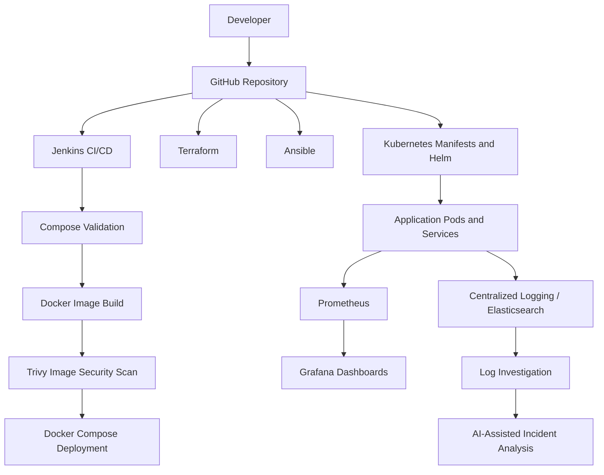

# AI-Powered E-Commerce DevOps Architecture

## Components
- Git/GitHub: source control and collaboration.
- Jenkins: automated validation, image build, security scan and deployment.
- Docker/Compose: container packaging and local deployment.
- Terraform/Ansible: infrastructure and configuration automation.
- Kubernetes/Helm: orchestration and application packaging.
- Prometheus/Grafana: metrics and visualization.
- Elasticsearch: log storage and search capability.
- Trivy: container vulnerability scanning.

This diagram represents the intended project architecture, not a live topology export. Cloud deployment and AI integration must be documented according to actual implementation evidence.
